## {.title-slide}

::: divider
[MSc Neuroscience, GSN]{.kicker}

<h1>Multitask Dale's-law RNNs under rate and synaptic budgets</h1>

Atharv Suryawanshi

:::

## One circuit, many tasks

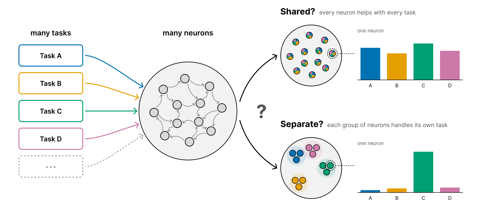{.fig style="height:470px"}

::: take
When one circuit does many tasks, do its neurons share the work, or split into task-specific groups?
:::

## Yang et al. 2019: one network, 20 tasks

::: {.grid2 style="margin-top:6px"}
::: card
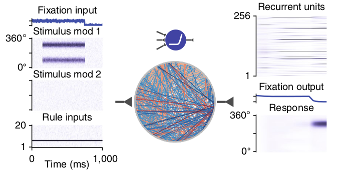{.fig style="height:250px"}

256 RNN units trained on 20 cognitive tasks at once: fixation, two stimulus rings and a rule input in; fixation
and a response ring out.

:::
::: card
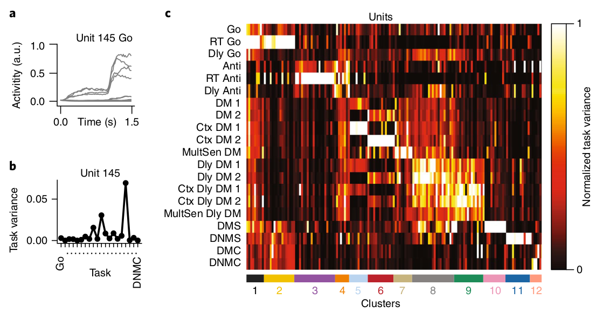{.fig style="height:250px"}

Task variance: how much each neuron takes part in each task. Neurons form clusters, each specialised for a group
of related tasks.

:::
:::

::: take
Trained on many tasks, one network forms groups of neurons for related tasks.
:::

[Yang, Joglekar, Song, Newsome & Wang (2019). *Nat. Neurosci.* 22, 297–306. Figs 1b, 2a–c.]{.cite-line}

## Song, Yang & Wang 2016: excitatory and inhibitory neurons

::: row
::: {style="width:50%"}
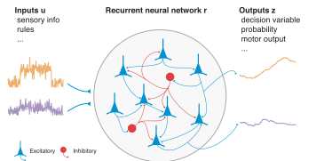{.fig style="height:400px"}
:::
::: grow
::: eq
$$
\begin{aligned}
\tau\dot{\mathbf{x}} &= -\mathbf{x} + W^{\mathrm{rec}}\mathbf{r} + W^{\mathrm{in}}\mathbf{u} + \text{noise}\\
\mathbf{r} &= [\mathbf{x}]_+, \qquad \mathbf{z} = W^{\mathrm{out}}\,\mathbf{r}_{\color{#1F8AD0}{\mathrm{E}}}\\[4pt]
W^{\mathrm{rec}} &= W^{\mathrm{rec},+}\,D, \qquad W^{\mathrm{rec},+} \geq 0\\
D &= \mathrm{diag}(\underbrace{\color{#1F8AD0}{+1,\dots,+1}}_{\text{E}},\ \underbrace{\color{#E0393E}{-1,\dots,-1}}_{\text{I}})
\end{aligned}
$$
:::

::: {.card .defs}

Dale's law: each neuron is excitatory or inhibitory (80 / 20); the
sign of its outgoing synapses is fixed.

One network per task (decision making, working memory, …); activity resembles recordings.

:::
:::
:::

::: take
Separate [E]{.E} and [I]{.I} neurons (80/20): we keep this in all our networks.
:::

[Song, Yang & Wang (2016). *PLoS Comput. Biol.* 12(2), e1004792. Fig. 1, Eqs 1–3, 12.]{.cite-line}

## Real neurons pay for activity and for synapses

::: {.row .top}
::: {.grow}
::: {.card .defs style="margin-bottom:12px"}

Activity costs energy: most of the brain's energy goes into spikes and synaptic transmission.

Attwell & Laughlin 2001; Lennie 2003

:::
::: {.card .defs style="margin-bottom:12px"}

Synapses cost space and material: axons and dendrites take up most of the grey matter.

Chklovskii, Schikorski & Stevens 2002

:::
::: {.card .defs}

No single cost is minimised. The best solutions form a trade-off (Pareto) front, each weighting the objectives
differently; there is no single optimum.

:::
:::
::: {style="width:50%;flex-shrink:0"}
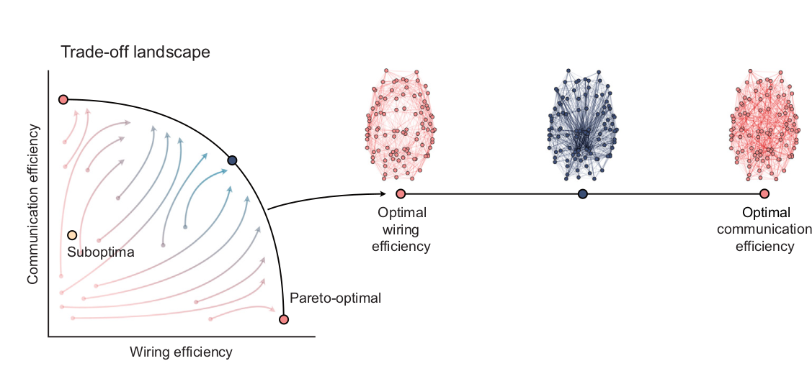{.fig}

Brain networks trade wiring cost against communication efficiency: suboptimal networks lie
inside, Pareto-optimal ones on the frontier. Fakhar & Astle (2026). <i>Trends Cogn. Sci.</i> Fig. 1.

:::
:::

::: take
What does a circuit look like when it must solve many tasks and pay both costs, and where on the trade-off does it
sit?
:::

## Setup

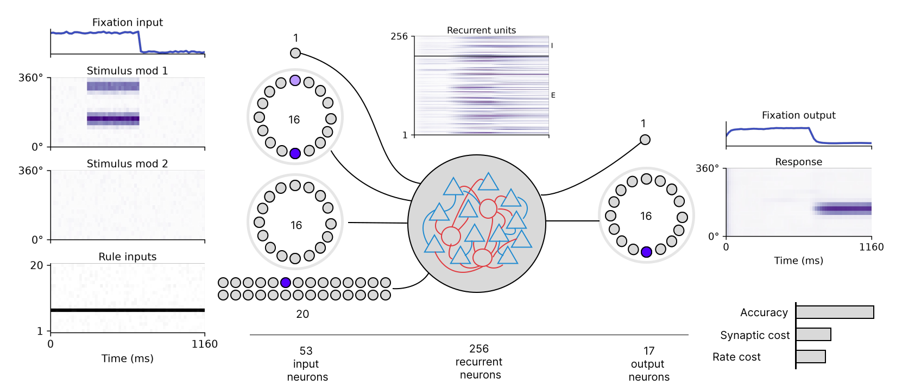{.fig style="height:420px"}

256 rate neurons (204 E, 52 I), all 20 Yang tasks
trained together in one network, 150k steps.

::: take
Each network is scored on three things: task accuracy, synaptic cost and rate cost.
:::

## The network

::: eq
$$
\begin{aligned}
\mathbf{r}_t &= (1-\alpha)\,\mathbf{r}_{t-1} + \alpha\,\big[\,W^{\mathrm{in}}\mathbf{u}_t + W^{\mathrm{rec}}\mathbf{r}_{t-1} + \mathbf{b} + \sigma\boldsymbol{\xi}_t\,\big]_+,
  \qquad \alpha = \Delta t/\tau = 20\,\text{ms}/100\,\text{ms}\\[8pt]
W^{\mathrm{rec}} &= \big(\mathrm{softplus}(\Theta)\odot(\mathbf{1}-I)\big)\,D,
  \qquad D = \mathrm{diag}(\underbrace{\color{#1F8AD0}{+1,\dots,+1}}_{204\ \text{E}},\ \underbrace{\color{#E0393E}{-1,\dots,-1}}_{52\ \text{I}})\\[8pt]
\hat{\mathbf{y}}_t &= \mathrm{sigmoid}\big(W^{\mathrm{out}}\,\mathbf{r}^{\color{#1F8AD0}{\mathrm{E}}}_t + \mathbf{b}^{\mathrm{out}}\big)
\end{aligned}
$$
:::

::: {.grid2 style="margin-top:14px"}
::: {.card .defs}

$\mathrm{softplus}(\Theta) \geq 0$: synaptic strengths. $D$: fixed sign of each presynaptic neuron (Dale).
$\mathbf{1}-I$: no autapses.

:::
::: {.card .defs}

Output read from E neurons only. Input, recurrent and output synapses all learned
(gradient descent, 150k steps).

:::
:::

::: take
A rate network with Dale's law: each neuron is [E]{.E} or [I]{.I}, and only [E]{.E} neurons project to the output.
:::

## Three objectives

::: {.grid3 style="margin-top:20px;font-size:23px"}
::: card
[Task]{.kicker}
$$L_{\text{task}} = \Big\langle \frac{\sum_{t,k} m_{tk}\,(\hat y_{tk} - y_{tk})^2}{\sum_{t,k} m_{tk}} \Big\rangle_{\text{trials}}$$

Squared error where the target matters ($m$), each trial weighted equally.

:::
::: card
[Rate]{.kicker}
$$C_{\text{rate}} = \big\langle\, r_i(t)^2 \,\big\rangle_{\text{trials},\,t,\,i}$$

Mean squared rate over trials, time and neurons.

:::
::: card
[Synaptic]{.kicker}
$$C_{\text{syn}} = \frac{1}{N(N-1)} \sum_{i \neq j} \frac{|W^{\mathrm{rec}}_{ij}|}{c_j}$$
$$c_j = \begin{cases} 1 & j \in \color{#1F8AD0}{\text{E}}\\ n_{\text{E}}/n_{\text{I}} & j \in \color{#E0393E}{\text{I}} \end{cases}$$

Total recurrent synaptic strength. I synapses are about 4× stronger, so we divide by
$c_j$; otherwise inhibition would be cut first.

:::
:::

::: take
Three objectives: do the tasks, keep rates low, keep total synaptic strength low.
:::

## Holding the network to a budget

::: grid2
::: {.card .defs}
[Synaptic cost: hard limit]{.kicker}

After every learning step, the same amount $\theta$ is subtracted from every synapse until the total strength is
back at the budget; synapses that reach zero are removed. This is subtractive normalisation (Miller & MacKay 1994),
the rule that drives weak synapses to zero. Here there is one budget for the whole network, not one per neuron.

<i style="border:1.5px dashed #9fb7cc"></i>before
<i style="background:#1F8AD0"></i>after: each synapse − θ× removed

×

×

$$|W_{ij}| \leftarrow \max\big(|W_{ij}| - \theta,\ 0\big),\quad \theta:\ C_{\text{syn}} = B_{\text{syn}}$$
:::
::: {.card .defs}
[Rate cost: soft limit]{.kicker}

Rates can't be cut like synapses, so we add a penalty. Its weight $\lambda$ rises while the network is above
budget and falls while it is below, like integral control of firing-rate homeostasis towards a set point (Turrigiano
2008; O'Leary et al. 2014). The $\rho$ term adds a push-back that acts only above budget and grows with the overshoot
($\rho = 1$).

$$
\begin{aligned}
L &= L_{\text{task}} + \lambda\,C_{\text{rate}} + \tfrac{\rho}{2}\,B_{\text{rate}}\big[\tfrac{C_{\text{rate}}}{B_{\text{rate}}} - 1\big]_+^2\\
\log\lambda &\leftarrow \log\lambda + \eta\,\big(\tfrac{C_{\text{rate}}}{B_{\text{rate}}} - 1\big)
\end{aligned}
$$

Soft: trained networks end about 1.5× above their rate budget.

:::
:::

::: take
No hand-set trade-off: each network gets two ceilings $(B_{\text{rate}}, B_{\text{syn}})$ and does the tasks as well
as it can under them.
:::

[Miller & MacKay 1994; Duchi et al. 2008 (L1 projection); Turrigiano 2008; O'Leary et al. 2014.]{.cite-line}

## Mapping the front: NSGA-III

::: row
::: {style="width:64%"}
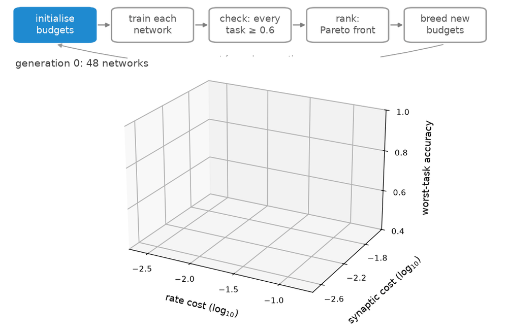{.fig style="height:470px"}
:::
::: grow
::: defs

Objectives: worst-task accuracy up, rate cost and synaptic cost down.

Each point is one network, trained under its own pair of budgets.

Front: networks where no objective can improve without another getting worse.

NSGA-III keeps the front and a spread along it, then makes new budgets from them.

One real search, generations 0 and 1 (48 networks each).

:::
:::
:::

::: take
The search chooses the budgets, training does the rest; over generations the population moves onto the front.
:::

[Deb & Jain 2014 (NSGA-III); Blank & Deb 2020 (pymoo).]{.cite-line}

## The front

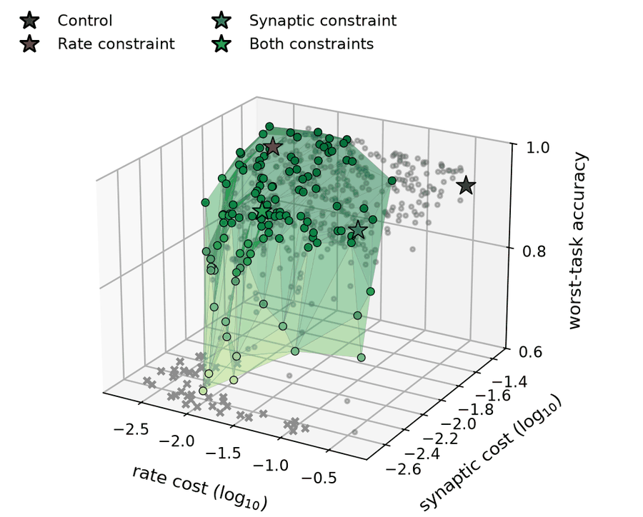{.fig style="height:450px"}

4 NSGA-III searches, 573 networks: 532 do every task ($\geq 0.6$), 116 on the front. Stars: the
four points (next slide).

::: take
Accuracy is set mainly by the synaptic budget: a plateau, then a cliff once synaptic cost drops below about
$10^{-2.5}$.
:::

## Four points on the front

::: row
::: {style="width:45%"}
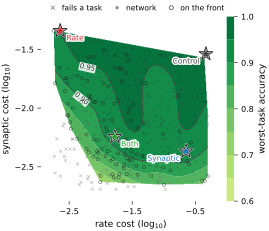{.fig style="height:440px"}
:::
::: grow
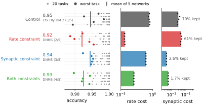{.fig}

5 seeds per point. Dots: single networks (accuracy colour: 0 red, 1 green). Bars: means.

:::
:::

::: take
Three constrained points with similar accuracy (0.92–0.94) but a different cost limiting each: 200× lower rates,
2–3% of synapses kept, or both.
:::

## Do they converge?

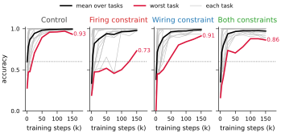{.fig style="height:440px"}

Old points and old task battery; to be replaced by the new points' training curves.

## Like-to-like connectivity

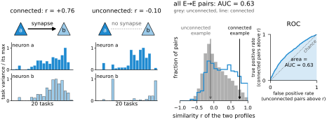{.fig style="height:300px"}

::: {.grid2 style="margin-top:8px"}
::: {.card .defs}

Task profile $x_i$: neuron $i$'s task variance (how much its rate varies across trials) in each of the 20 tasks,
divided by its largest value, so $0 \le x_{i,a} \le 1$ (bars above).

Similarity: $r_{ij} = \mathrm{corr}(x_i, x_j)$. Connected $j \to i$: $|W^{\mathrm{rec}}_{ij}| / c_j > 0.01$;
separately for E→E, E→I,
I→E, I→I.

:::
::: {.card .defs}

AUC $= P(r_{\text{conn}} > r_{\text{unconn}})$, the area under the ROC: 0.5 no relation, above 0.5 like-to-like,
below 0.5 like-to-unlike. It doesn't depend on how many synapses are kept.

Significance: shuffle the profiles within E and within I, synapses
fixed, 500×.

:::
:::

::: take
Question: are neurons that work in the same tasks more likely to be connected? (Example: both constraints, seed 0.)
:::

## Like-to-like connectivity: example network

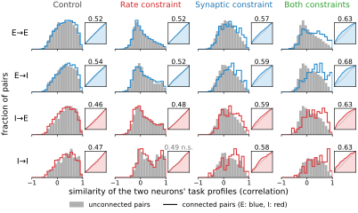{.fig style="height:440px"}

One network per point (seed 0). Grey: unconnected pairs; line: connected pairs. Small square: ROC
(false vs true positive rate); number: AUC, black if $p < 0.05$, grey "n.s." if not.

::: take
With a synaptic budget, connected neurons have more similar task profiles than unconnected ones; under control and
the rate budget the two distributions overlap.
:::

## Like-to-like connectivity: all 20 networks

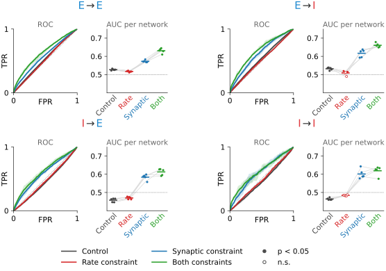{.fig style="height:410px"}

Top: ROC, mean over 5 seeds (band: seed range). Bottom: AUC per network, filled if $p < 0.05$;
grey lines join the same seed. Synapses kept: control 70%, rate 61%, synaptic 2.7%, both 1.8%. Cutting control and
rate-constraint networks to 1.8% afterwards (strongest synapses kept) gives AUC $\leq 0.54$.

::: take
Like-to-like connectivity comes with the synaptic budget, and is strongest where the fewest synapses are left (both
constraints, AUC 0.61–0.66). Pruning a dense network afterwards does not produce it.
:::

## Task variance and the number of groups

::: row
::: {style="width:34%"}
::: {.card .defs}

Task variance (Yang et al. 2019)

$$\mathrm{TV}_{i,a} = \big\langle \mathrm{Var}_{\text{trials}}\, r_i(t) \big\rangle_{t\,>\,\text{fixation}}$$

neuron $i$, task $a$; each neuron divided by its maximum (its task profile).

Groups: k-means on the profiles, E and I separately.

Silhouette $s = (b - a)/\max(a, b)$; $a$: mean distance to its own group, $b$: to the nearest other group.
Chosen $k$: the highest peak with $k > 2$.

:::
:::
::: grow
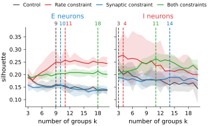{.fig style="width:100%;height:400px"}

5 seeds per point. Line: mean; band: seed range; dashed: chosen $k$ (highest peak of the mean,
$k > 2$).

:::
:::

::: take
Under a rate budget the groups are the most distinct (highest silhouette, [E]{.E} and [I]{.I}) and the most numerous.
The exact $k$ is soft: the curves are flat.
:::

## Groups of neurons at the four points

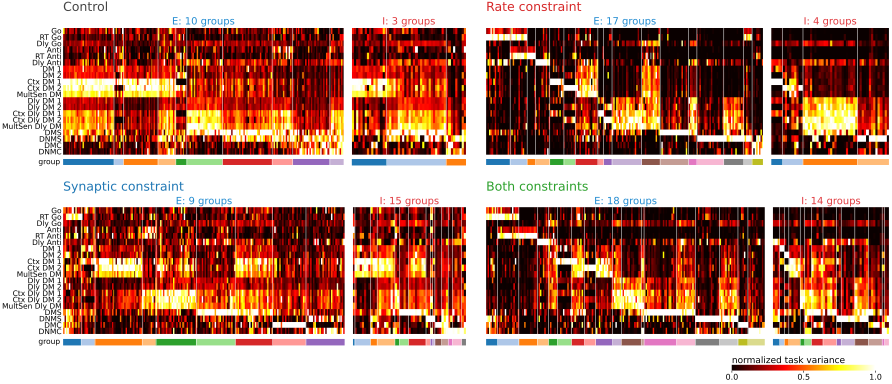{.fig style="height:460px"}

One network per point (seed 0, the most typical of the 5). Columns: neurons, sorted by group.

::: take
Under a rate budget [E]{.E} neurons take part in fewer tasks (3.1 vs 5.0 per neuron, every seed) and split into more
groups. A synaptic budget alone leaves them as broad as control (4.7).
:::

## Summary

::: {.grid3 .found .vcenter}
::: card
[The front]{.kicker}

10−2.5

Accuracy is set mainly by the synaptic budget: a plateau, then a cliff once synaptic cost drops below about this.

:::
::: card
[Synaptic budget]{.kicker}

0.61–0.66

Like-to-like AUC with both constraints; like-to-like connectivity comes with the synaptic budget, and pruning a dense
network afterwards does not produce it.

:::
::: card
[Rate budget]{.kicker}

3.1 vs 5.0

Tasks per E neuron under a rate budget vs control (every seed); the groups are the most
distinct and the most numerous.

:::
:::

## {}

::: divider
<h1>Experimental</h1>

Draft slides: synapses between groups, task periods and lesions (old points,
v1 task battery)

:::

## Task similarity and synapses: control [experimental]{.tag}

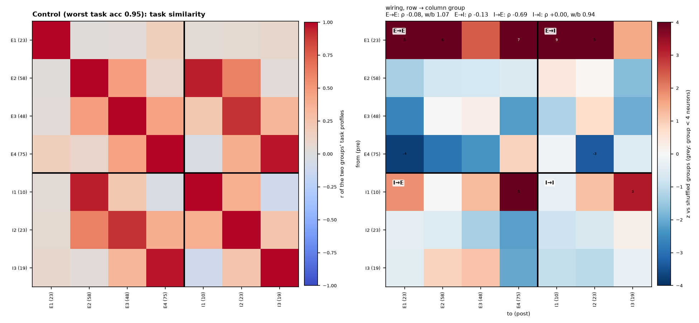{.fig style="height:500px"}

Left: task similarity $r$ between group profiles. Right: synapses row → column group, $z$ vs 500
shuffles of group labels (grey: group &lt; 4 neurons). This network (seed 4): $\rho_{\text{I}\to\text{E}} = -0.69$,
$\rho_{\text{E}\to\text{I}} = -0.13$, E→E within/between 1.07. All 5 seeds: $\rho_{\text{I}\to\text{E}}$ −0.69 to
−0.31; $\rho_{\text{E}\to\text{I}}$ −0.13 to +0.05; E→E 1.05–1.15.

## Task similarity and synapses: rate constraint [experimental]{.tag}

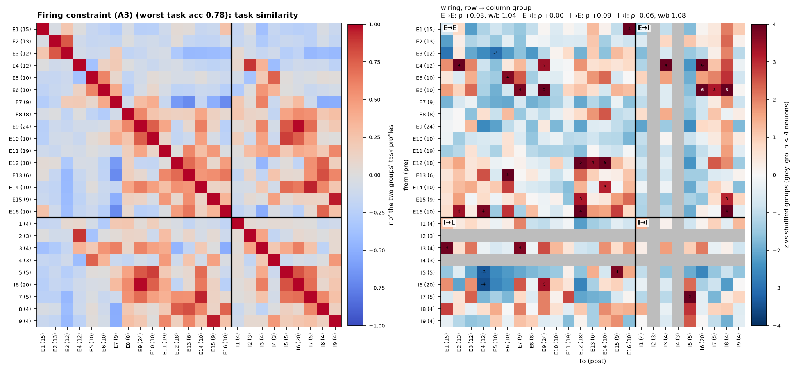{.fig style="height:500px"}

Left: task similarity $r$ between group profiles. Right: synapses row → column group, $z$ vs 500
shuffles of group labels (grey: group &lt; 4 neurons). This network (seed 4): $\rho_{\text{I}\to\text{E}} = +0.09$,
$\rho_{\text{E}\to\text{I}} = 0.00$, E→E within/between 1.04. All 5 seeds: $\rho_{\text{I}\to\text{E}}$ −0.05 to
+0.09; $\rho_{\text{E}\to\text{I}}$ −0.15 to +0.14; E→E 1.02–1.09.

## Task similarity and synapses: synaptic constraint [experimental]{.tag}

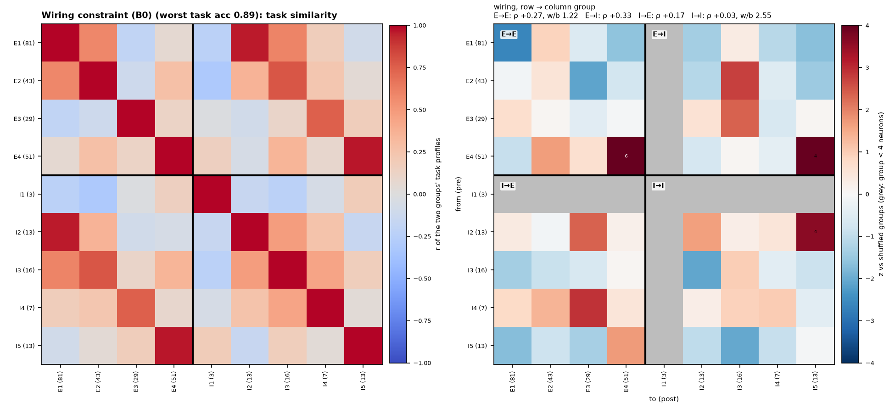{.fig style="height:500px"}

Left: task similarity $r$ between group profiles. Right: synapses row → column group, $z$ vs 500
shuffles of group labels (grey: group &lt; 4 neurons). This network (seed 4): $\rho_{\text{I}\to\text{E}} = +0.17$,
$\rho_{\text{E}\to\text{I}} = +0.33$, E→E within/between 1.22. All 5 seeds: $\rho_{\text{I}\to\text{E}}$ −0.05 to
+0.45; $\rho_{\text{E}\to\text{I}}$ −0.03 to +0.40; E→E 1.15–5.89.

## Task similarity and synapses: both constraints [experimental]{.tag}

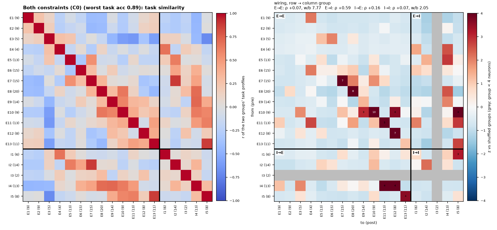{.fig style="height:500px"}

Left: task similarity $r$ between group profiles. Right: synapses row → column group, $z$ vs 500
shuffles of group labels (grey: group &lt; 4 neurons). This network (seed 4): $\rho_{\text{I}\to\text{E}} = +0.16$,
$\rho_{\text{E}\to\text{I}} = +0.59$, E→E within/between 7.77. All 5 seeds: $\rho_{\text{I}\to\text{E}}$ +0.07 to
+0.39; $\rho_{\text{E}\to\text{I}}$ +0.36 to +0.62; E→E 2.84–7.77.

## Task variance per task period [experimental]{.tag}

::: row
::: {.grow .defs}

We split each task into its periods $p \in \{$stimulus 1, memory 1, stimulus 2, memory 2, response$\}$, leave
out fixation, and get 59 (task, period) rows.

$$\mathrm{TV}_{i,(a,p)} = \frac{1}{|T_p|}\sum_{t \in T_p} \mathrm{Var}_{\text{trials}}\, r_i(t)$$

Length-weighted mean over a task's periods = per-task TV (to $3\cdot10^{-7}$).

Normalise: each active neuron (total TV > 1% of max) divided by its max over the rows, $x_i \in [0,1]^{59}$.

Ward clustering of neurons (columns) and of task periods (rows): merge the pair that least increases the
within-cluster variance,

$$\Delta(A,B) = \frac{|A|\,|B|}{|A|+|B|}\,\big\lVert \mu_A - \mu_B \big\rVert^2 .$$

$k$ per axis: highest silhouette over $k = 3,\dots,39$. Sparsity: fraction of entries &lt; 0.15.

Differences from Driscoll et al.: active rule (&gt;1% vs &gt;10⁻³), random trials instead of a
stimulus grid, $k$ by silhouette instead of a fixed cut height; E and I clustered together.

:::
::: {style="width:34%"}
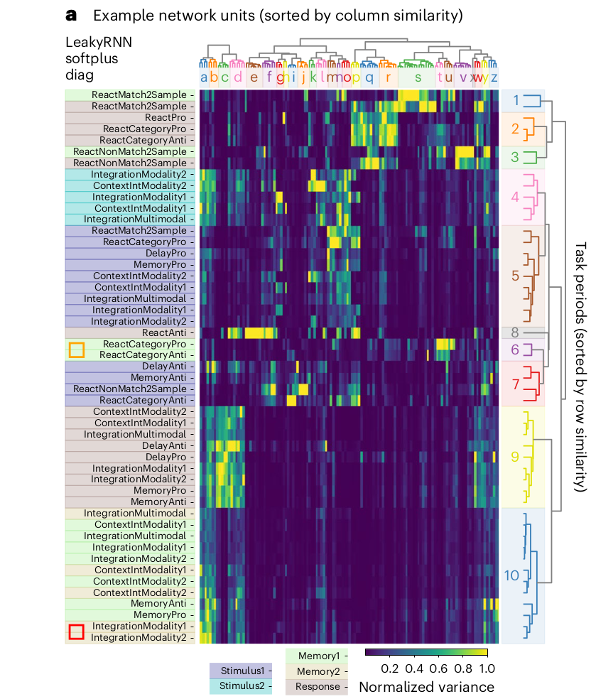{.fig style="height:540px"}

Driscoll, Shenoy & Sussillo (2024). <i>Nat. Neurosci.</i> 27, 1349–1363.
Fig. 3a.

:::
:::

## Task periods: control vs. rate constraint [experimental]{.tag}

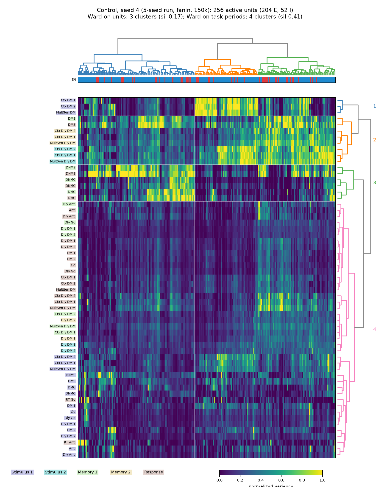
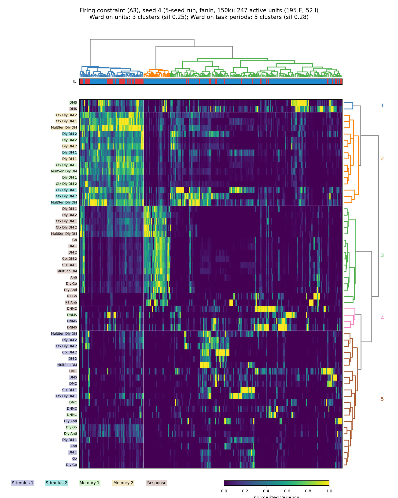

Example network (seed 4). Sparsity E / I: control
0.43 / 0.39, rate constraint 0.79 / 0.62. Row label colour = period type.

## Task periods: synaptic vs. both constraints [experimental]{.tag}

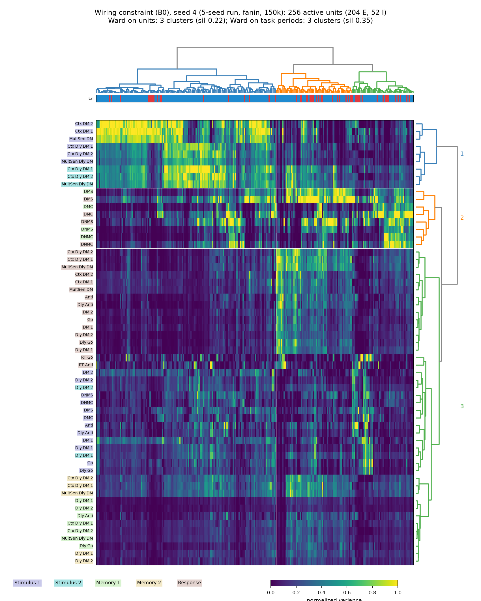
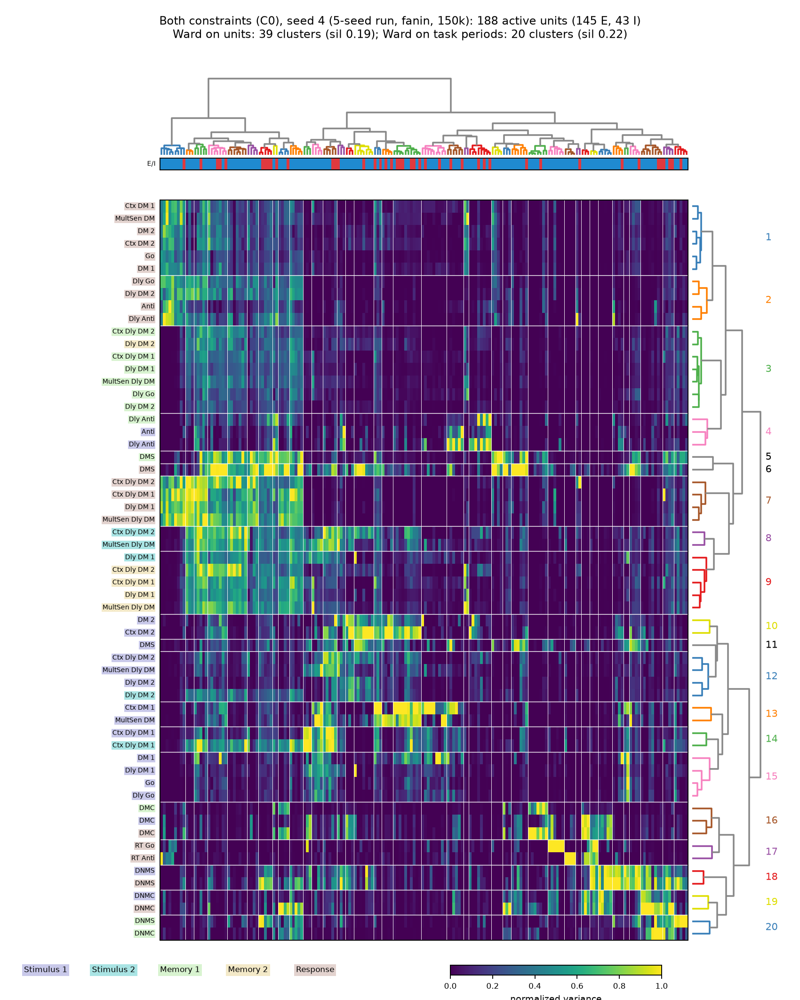

Example network (seed 4). Sparsity E / I: synaptic
constraint 0.48 / 0.48, both constraints 0.69 / 0.63. Row label colour = period type.

## Lesions on task-period groups [experimental]{.tag}

::: {.grid2 .defs}
::: {.gcol}

Groups: per-period task variance (59 rows, each neuron divided by its max), Ward clustering,
E and I separately, fixed $k$: 14 E groups (5
task families × stimulus / memory / response; DM has no memory period), 5 I groups (the task
families).

Lesion group $g$: $r_i(t) = 0$ for all $i \in g$ at every time step (Driscoll et al. 2024).

Damage on task $a$, relative to the intact network (10 eval seeds × 64 trials, no noise):

$$\Delta_{g,a} = \frac{\mathrm{acc}_{g,a} - \mathrm{acc}_a}{\mathrm{acc}_a}$$
:::
::: {.gcol}

Module contrast: does lesioning $g$ hurt a set of tasks $M$ more than a reference set?

$$C_{g,M} = \big\langle \Delta_{g,a} \big\rangle_{a \in M} - \big\langle \Delta_{g,a} \big\rangle_{a \in \mathrm{ref}(M)},
\qquad C < 0:\ M \text{ hurt more}$$
<table class="mod-table">
<tr><td>Anti tasks</td><td>vs. all other tasks</td></tr>
<tr><td>tasks with a delay (Dly, Go, Anti)</td><td>vs. all other tasks</td></tr>
<tr><td>modality 1 DM tasks</td><td>vs. modality 2</td></tr>
<tr><td>DMC (categorical memory)</td><td>vs. Dly tasks (continuous memory)</td></tr>
</table>

As Driscoll et al. Fig. 5. No control for group size. v1 task battery, seed 4.

:::
:::

## Lesions on task-period groups: four points [experimental]{.tag}

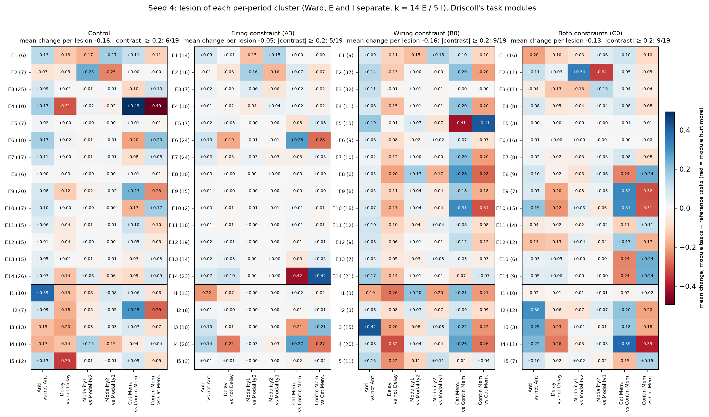{.fig style="height:480px"}

Mean change per lesion: control −0.16, rate constraint −0.05, synaptic constraint −0.16, both
constraints −0.13. Groups with $|C| \geq 0.2$: 6, 5, 9 and 9 of 19. Results change with $k$.

## The front, interactive [extra]{.tag}



Same networks as "The front": drag to rotate, hover for one network (run, budgets, accuracy, costs,
synapses kept).

## Like-to-like AUC, mean over 5 seeds [extra]{.tag}

::: {style="margin-top:20px"}

:::

Same numbers as "Like-to-like connectivity: all 20
networks" (per-task profiles, front run). Purple: like-to-like; orange: like-to-unlike. Hover a cell: seeds with
$p < 0.05$.

## {}

::: divider
<h1>Thank you</h1>
:::
