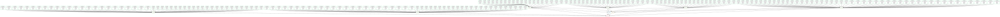

**Matriculation number:** ____________

**Code, data and pipeline:** [github.com/AtharvSuryawanshi/canonical_mc](https://github.com/AtharvSuryawanshi/canonical_mc/tree/selectivity-report-v1),
at the tag `selectivity-report-v1`, the exact version this report was built from (see [Reproduce](#reproduce)).

## Introduction

Every action potential costs energy and every synaptic connection costs space and wiring material,
so cortical circuits are shaped by what they compute and by what that computation costs
(Attwell & Laughlin 2001; Chklovskii et al. 2002). If cost shapes circuits, it may also shape how a
circuit shares out its work: whether each neuron takes part in many tasks or in only a few.

Recurrent neural networks (RNNs) trained on cognitive tasks let us ask this directly. Even with no
cost at all, a single RNN trained on many tasks forms groups of units that serve particular tasks
(Yang et al. 2019), and constraints on connectivity are known to change what multitask RNNs learn
(Khona et al. 2023; Achterberg et al. 2023). What has not been separated is *which* cost pushes
single neurons from mixed (taking part in many tasks) to specialized (taking part in few): the cost
of firing or the cost of wiring.

**Question.** In RNNs that obey Dale's law and are trained on 20 cognitive tasks, does a budget on
firing rate make excitatory units take part in fewer tasks than in networks without a budget, and
does a budget on wiring do the same?

**Expectation.** Yes for firing, no for wiring: networks with a rate budget, alone or together with
a wiring budget, should have narrower E units than control, and a wiring budget alone should leave
them about as broad as control. Under a firing-rate budget a unit pays for its
activity on every task it joins, so it should pay to join fewer. A wiring budget limits which units
talk to each other rather than how many tasks a unit's activity follows, so on its own it should
leave that number roughly unchanged.

This expectation grew out of earlier exploration in a larger project, and that exploration had
already looked at the very networks analysed here. The same breadth metric had been computed for
all 20 main-set networks (and for a set of networks with a frozen readout), and a similar version,
averaged over all active units rather than E units only, for the second set. The direction of the
result was therefore known before this study began, and the main-set test confirms a known result
rather than predicting an unseen one. What was fixed in advance is the test itself: before this
analysis pipeline ran, we wrote down what we expected, how we would measure it, and which results
would prove us wrong. Two criteria were clarified in writing, still before the pipeline produced any
result, and nothing was changed afterwards. This report applies that fixed test to already-trained
networks, with unconstrained controls and a second set of networks as a consistency check.

## Approach

### Networks

The networks come from a larger project that asks whether circuit features typical of cortex
emerge when a network must solve many tasks while paying for firing and for wiring. Each is an RNN
of 256 units that obeys Dale's law: every unit is either **excitatory (E)**, with all of its
outgoing recurrent weights positive, or **inhibitory (I)**, with all of them negative. 80 % of
units are excitatory (204 E, 52 I), and every network is trained on the same 20-task cognitive
battery as Yang et al. (2019).

A **cost** is a quantity, computed from the network, that the brain would have to pay for. We use
two, both dimensionless:

- **Rate cost** (also *metabolic cost*): the mean squared firing rate over units, time steps and
  trials. A unit's firing rate is its rectified (non-negative) activity.
- **Wiring cost**: the mean absolute strength of the recurrent connections, per connection.

In both, E and I units are weighted so neither population is penalized more just because of
its size.

A **budget**, our model of the brain's energy and wiring economy, is a ceiling on a cost during
training: the network must learn the tasks while keeping that cost at or below the ceiling.
The wiring budget is enforced exactly: after every training step, recurrent weights that exceed it
are scaled back onto it. The rate budget is enforced by a **multiplier**, a learned weight on the
rate cost in the training loss. It grows while the cost is above its
budget and shrinks while it is below, down to a floor of 10⁻⁶ that means "off". A budget **binds**
if the cost sits at its ceiling at the end of training (for the rate budget, with its multiplier
also above the floor). A **loose** budget is set so far above what the network uses that it never
binds.

A network's **worst-task accuracy** is its accuracy on its worst task, and a network is
**feasible** if that accuracy is at least 0.6 (60 %).

All networks were trained earlier in the larger project, with budget values chosen there, so this
report involves no new training. There are two sets. The **main set** has four conditions with
5 networks each, trained for 150 000 steps. The **second set** has four conditions with 12 networks
each, trained for 50 000 steps with different budget values and an older initialization of the
readout weights, so it checks the direction of an effect but not its size. In both sets the networks
of a run were trained together, in batches that share one stream of training trials (all 20
main-set networks in one batch), so networks are not fully independent of each other. Networks in one condition differ only in their random seed, which also
identifies them.

### Conditions

| set | condition | rate budget | wiring budget | what it means |
|---|---|---|---|---|
| main | control | none | none | unconstrained reference |
| main | rate-only | tight | loose | firing is limited, wiring is free |
| main | wiring-only | loose | tight | wiring is limited, firing is free |
| main | both budgets | at ceiling | tight | both limited; wiring binds, and the rate cost sits at its ceiling, with the multiplier clearly above its floor in 1 of 5 networks |
| second | control | none | none | unconstrained reference |
| second | rate-limited | tight | binds, near control's level | firing is limited, wiring mildly |
| second | wiring-limited | set, does not bind | tight | wiring is limited, firing is not |
| second | both budgets | tight | tight | both limited |

*Tight* means far below what control networks use, and binding. *At ceiling* means the cost ends
at its budget while the multiplier is mostly at its floor. For scale, control networks have a rate
cost of 0.36–0.55 and a wiring cost of 0.024–0.036, and keep 67–79 % of their possible recurrent
connections (the *connection fraction*: connections whose normalized strength is above 0.01). The
main set's wiring-only budget (0.0054) leaves a connection fraction of 0.047–0.060, so it removes
about 92 % of the connections a control network keeps. In the second set, the rate-limited networks'
wiring budget also binds and removes about 30 % (connection fraction 0.44–0.54). In the repository the main-set conditions are
coded A3 (rate-only), B0 (wiring-only) and C0 (both budgets), and the second set's both-budgets
condition is coded "knee".

::: {.callout-note collapse="true" title="Exact budget values"}

| set | condition | rate budget | wiring budget | which budget binds |
|---|---|---|---|---|
| main | control | none | none | — |
| main | rate-only | 0.0011 | 1.0 (loose) | rate |
| main | wiring-only | 10 (loose) | 0.0054 | wiring |
| main | both budgets | 0.0115 | 0.0044 | wiring; the rate cost sits at its ceiling, multiplier clearly above the floor in 1 of 5 networks |
| second | control | none | none | — |
| second | rate-limited | 0.0037 | 0.0237 | both (the wiring budget is just below control's wiring cost) |
| second | wiring-limited | 0.0231 | 0.0020 | wiring only |
| second | both budgets | 0.0046 | 0.0025 | both |

The budgets act on the costs measured on training batches, whereas the costs reported in Results
are measured after training on evaluation trials, where the rate cost is 1.3–2.0 times larger (see
Limitations).

:::

### Measure: task breadth

We start from each unit's **task variance**: how much the unit's firing rate varies across noise-free trials of a task, averaged over time from fixation
onset (Yang et al. 2019). A unit with high task variance on a task is engaged by it.

- An **active unit** is one whose task variance, summed over the 20 tasks, exceeds 1 % of the
  largest such sum in the same network. Silent units are left out.
- Each unit's 20 task variances are divided by its own largest value, so a quiet unit does not
  look more selective merely for being quiet.
- A unit's **breadth** is the number of tasks whose normalized variance exceeds a threshold (0.5
  unless stated), so 1 means a single task and 20 means all of them.
- A network's **E breadth** is the mean breadth of its active E units, so the unit of analysis is
  the network, not the neuron.

### What would show the expectation wrong

Before this pipeline ran, and knowing the earlier exploratory results described above, we stated
six outcomes that would show our expectation to be wrong.
All concern E breadth and keep the number and name they were registered under. Unless a rule says
otherwise, it is tested on the main set at threshold 0.5. A rule *passes* when its outcome does not
occur, and a tie counts against the expectation.

*Is there a rate effect at all?*

1. *No rate effect.* If any rate-only network is as broad as the narrowest control network, there
   is no rate effect.
2. *Threshold artefact.* If, at threshold 0.3 or at 0.7, any rate-only network is as broad as the
   narrowest control network, the effect is an artefact of the threshold.

*Could something other than the budget explain it?*

3. *Accuracy, not budget.* If, across all 20 main-set networks, worst-task accuracy explains E
   breadth as well as the condition does, then narrowing reflects lower accuracy, not the budget.
   Concretely: if any rate-only network whose worst-task accuracy is at least that of the least
   accurate control network has an E breadth inside the control range. Only this concrete test
   decides the rule; the correlation between breadth and accuracy is reported alongside it.
4. *Population artefact.* If rate-only networks keep, on average, fewer than half as many active E
   units as control networks, the units that remain are not comparable.

*Does it hold in other networks?*

5. *Does not replicate.* If, in the second set, the mean E breadth of rate-limited networks is not
   below that of control networks, the effect does not replicate. Only feasible networks count.
   Because only 3 of 12 rate-limited networks are feasible, this test is weak whichever way it
   comes out.

*Is the wiring half right?*

6. *Wiring does specialize.* If every wiring-only network is narrower than the narrowest control
   network, a wiring budget does narrow E units, and the expectation that it leaves them unchanged
   is wrong.

Rules 2 and 5 are stated with their written clarifications (either threshold; feasible networks
only).

## Results

![**E breadth per network.** Breadth = the number of tasks (out of 20) whose normalized task
variance exceeds the threshold, averaged over a network's active E units. Each dot is one network
(main set: 5 per condition; second set: 12); in a, b and d the bar is the mean of all networks in
the condition, feasible and infeasible (rule 5 uses feasible networks only), and the dashed line
marks the lowest control network. Colours: grey control, orange rate budget, blue wiring
budget, green both budgets (the same in both sets). Hollow dots are infeasible networks (worst-task
accuracy < 0.6; every main-set network is feasible). (a) Main set, threshold 0.5. (b) Main set,
thresholds 0.3 (top) and 0.7 (bottom); y-axis ranges differ because a higher threshold counts fewer
tasks. (c) Main set, E breadth (threshold 0.5) against worst-task accuracy. (d) Second set,
threshold 0.5.](../results/selectivity/breadth.png){#fig-breadth}

### A rate budget narrows excitatory units

Excitatory units take part in fewer tasks when firing is budgeted. At threshold 0.5 every
rate-only network has a lower E breadth than the narrowest control network (@fig-breadth a), so
rule 1 passes. An active E unit in a rate-only network takes part in 2.9 of the 20 tasks on
average, against 4.7 in a control network. With five networks per condition, a complete
separation like this has an exact one-sided p ≈ 0.004. That value assumes independent networks,
and these were trained on a shared stream of training trials, so it is only approximate.

### The effect survives the threshold, accuracy and the loss of units

The separation does not depend on the threshold: at 0.3 and at 0.7 every rate-only network is
again narrower than every control network (@fig-breadth b), so rule 2 passes.

Lower accuracy does not explain the narrowing. A rate budget costs some accuracy, so narrow
units could be a symptom of a network that solves its tasks less well. Two observations argue
against this (@fig-breadth c). First, the most accurate rate-only network solves its worst task
better than the least accurate control network (0.963 against 0.939), yet its E breadth of 2.9 is
far below the control range. Rule 3 therefore passes, but only its concrete part was tested, and on this one network. Across
all 20 networks breadth rises weakly with worst-task accuracy (Spearman ρ 0.37, p 0.11; see the
table), and within control the least accurate network is also the narrowest, so accuracy is not
ruled out as a partial influence. Second, wiring-only networks are about as accurate as rate-only
ones, yet stay broad.

Nor is the narrowing produced by a shrunken population. Rate-only networks keep 195 of their
204 E units active on average, far more than the half that rule 4 requires.

### The main set's wiring budget alone does not narrow excitatory units

A wiring budget on its own, at the main set's level, leaves E units at least as broad as in
control, even though it removes about 92 % of control's connections. No wiring-only network
is narrower than the narrowest control network, so rule 6 passes (@fig-breadth a). At threshold 0.3
every wiring-only network is broader than every control network (@fig-breadth b), and these
networks also fire more than control. Networks with both budgets lie in between and have fewer
active E units. They are narrower than control, as the expectation said, but no registered rule
tests them.

### The second set points the same way, but the test is weak

In the second set, rate-limited networks are also narrower than control, but only three of them
count. Rule 5 uses feasible networks only, and just 3 of the 12 rate-limited networks are feasible.
Their mean E breadth is 3.39, against 4.92 for control (@fig-breadth d), so rule 5 passes. As
stated before the pipeline ran, though, the test is weak whichever way it comes out, and an earlier
exploratory analysis had already seen the same direction in this set. The two sets also differ in
readout initialization, and the rate-limited networks' wiring budget removes about 30 % of
connections, so this is not a pure rate condition. With different budgets and a
third of the training, this set speaks to the direction of the effect, not
its size.

**Registered claim.** In the main set, a binding rate budget narrows the task breadth of E units,
and a wiring budget alone, at the main set's level (about 92 % of control's connections removed),
does not. The second set agrees, on 3 feasible networks.

**Registered tests.** pass = the claim survived this test; the row "5, all 12" is supplementary.



**Per condition, threshold 0.5.** *Active E*: mean number of active E units, out of 204;
*metabolic cost*: the rate cost measured after training.



### Exploratory, not pre-registered: narrowing tracks low firing

*This observation was made after the rules were fixed. It was not part of the registered test and
needs a test of its own.*

Every condition that narrows fires far less than control, whichever budget brought the firing
down. Three observations point this way:

- In the second set, wiring-limited networks are as narrow as rate-limited ones, although their
  rate budget never binds (its multiplier stays at the floor in all 12 networks). Their wiring
  budget is tighter than in the main set (0.0020, against 0.0054 for wiring-only), and on its own
  it lowers the metabolic cost (a mean squared firing rate) about 13-fold relative to control.
- In the main set's both-budgets condition the metabolic cost is about 25-fold below control. The
  rate cost sits at its ceiling, although the multiplier is clearly above its floor in only 1
  of 5 networks.
- Wiring-only networks, the one budgeted condition that stays broad, have a *higher* metabolic cost
  than control.

For the conditions with a tight wiring budget, two accounts fit equally well. Breadth may follow
how much a network actually fires, or how tight its wiring budget is: the narrowing ones (both
budgets in either set, and wiring-limited) have wiring budgets of 0.0044 or below and fire little,
while the one broad one (wiring-only, 0.0054) fires more than control. In these data the two are
confounded, so wiring tightness is an equal alternative to firing there. Only rate-only, which
narrows with a loose wiring budget, points to firing alone. Breadth is also not graded with firing:
second-set wiring-limited networks fire about five times more than rate-limited ones (see the
table) yet are just as narrow. Either way, the wiring null holds for the main set's wiring level and
not for wiring in general.

## Workflow

The analysis is one automated pipeline from the saved, already-trained networks to the tables and
figure in this report. It computes every unit's task breadth, condenses the
units into one row per network, then applies the six rules, draws the figure and writes the
tables. Each step has its own check.

- **Tools.** The pipeline runs in Snakemake, a workflow tool that reruns only the steps whose
  inputs changed, inside a locked pixi environment (a pinned list of software versions), on a CPU.
  Training ran elsewhere and is not part of it.
- **Steps** (Snakemake calls them "rules", but they are not the six pre-registered rules). Each
  saved network at each threshold becomes a table with one row per unit, giving 204 unit tables
  (68 networks, 20 + 48, at 3 thresholds). These are condensed into one row per network, and the
  last steps compute the pass/fail table, draw the figure and write the two tables above.
- **Checks.** The metric recovers the known breadth of synthetic units (ground truth), and
  boundary tests confirm that a tie counts against the claim. All 20 main-set networks agree to 3 decimals
  with the earlier exploratory implementation, which is separate code but the same analysis. The plotted values were read back from the
  figure, and a rebuild from scratch gave byte-identical outputs. The tables and figure are
  generated by the pipeline; the numbers in the prose were copied from them by hand.

{#fig-dag}

### Reproduce

Everything needed is in the repository: the trained networks are committed as saved model
files (checkpoints), one per network. They take 167 MB for the main set and 241 MB for the second
set, and only the final checkpoints are used, not the ones saved halfway through training. All saved
runs together take about 1.7 GB, so the clone is large. The analysis lives on the `agent-course`
branch; the tag `selectivity-report-v1` below is the exact version this report was built from.

```bash
git clone https://github.com/AtharvSuryawanshi/canonical_mc.git
cd canonical_mc
git checkout selectivity-report-v1
pixi install        # locked environment from pixi.lock
pixi run test       # ground-truth tests
pixi run pipeline   # networks -> tables -> verdicts -> figure -> report tables
pixi run dag        # reports/dag.svg
pixi run report     # this document
```

## How agents were used

I used AI agents (Claude Code) for much of the reading and coding; I set the question, the rules
and the claim and approved every change. Agents were used extensively to code the analysis
pipeline, built on Song, Yang & Wang (2016) and Yang et al. (2019), and summarised background
papers into my notes, which I checked against the papers. I also built a paper-reading Skill (one
quote per claim, "not in the paper" when the paper is silent) and wrote reports in Quarto.

A **spec** (the study plan, fixed before this pipeline ran) and a **progress file** (a running log
with evidence) steered the work. A planning agent proposed steps, a builder agent built and checked them one at a
time but never committed, and fresh-context, read-only agents tried to break the result: the agent
that did the work never graded it.

| stage | delegated to an agent | decided by me | checked by |
|---|---|---|---|
| question, expectation, pass/fail rules | — | written after earlier exploration of these networks, before this pipeline; never edited | — |
| plan | reading the data, drafting steps and checks | approval; clarifying rules 2 and 5 | plan fixed in the spec first |
| metric code | metric and tests | — | ground-truth tests; earlier exploratory implementation (20/20 networks) |
| rule code | pass/fail logic | the comparisons, checked against the plan | boundary tests (ties, closed ranges) |
| figure, tables | plotting, generated tables | panels, condition and set names | plotted dots read back against the tables |
| reproducibility | rebuild from scratch | — | checksums of every output, identical |
| review | finding weaknesses in the claims | accepting all 5 findings; revising the explanation | builder re-checked the key numbers of three findings |
| commits, report text | drafting; rewriting, readability review and editing by fresh-context subagents | every commit and edit to the claim | diff read before each commit |
| final examination | adversarial check of claims, numbers, rules, reproducibility | which of 10 findings to act on (all, wording only, no new analysis) | builder verified each premise against the files before editing; full rebuild, 214 outputs identical |

The routine paid off early: planning found only 3 of the 12 rate-limited networks in the second set
feasible, and rule 5 was clarified before the pipeline produced any result.

The reviewer made the most useful catch on the science: my stated reason, that wherever a wiring
budget narrows units a rate budget is also active, was wrong, because the second set's
wiring-limited networks narrow while their rate budget does not bind. The verdicts stood, the
explanation changed, and the firing-rate account became exploratory.

Once the report was drafted, a fresh-context, read-only agent acting as a sceptical external
examiner checked every claim against the result files, the training logs and the git history. Its most
important finding was that the report said the rules were written "before looking at any result",
while the history shows the same metric had been computed on these networks earlier. That overclaim
had crept in through successive rewrites, so I corrected the disclosure. It also found the wiring
budget described inconsistently and the exploratory firing-rate claim overstated. Not every finding
was right, though: the builder checked one against the data and corrected it, so the examiner's
claims were verified too, not accepted blindly.

## Limitations

The main set has only five networks per condition, so "all rate-only networks" describes these
networks, not a population of possible networks.

Each budget was tested at one level. Wiring-only is a single wiring budget (0.0054, about 92 % of
control's connections removed), and the second set shows that a tighter one (0.0020) does narrow
E units. Our result is therefore that a wiring budget at the main set's level does not narrow them,
not that wiring never does.

The consistency check is weak. Most budgeted networks in the second set are infeasible, its budgets
differ from those of the main set, its readout weights were initialized differently, its
rate-limited networks also have a binding wiring budget, and its networks were trained for a third
as long. Networks within a run share their training trials, so they are not fully independent.

Some conditions lose active units. The main set's both-budgets condition and the second set's
wiring-limited and both-budgets conditions lose 11–23 % of their active E units, yet rule 4 tests
this only for rate-only networks.

We do not explain the mechanism. On its own, a mean squared rate favours spreading activity
thinly rather than concentrating it, so why low firing narrows tuning remains open.

The metric involves choices. Breadth depends on the activity cut-off (1 %) and on the
normalization, and while we varied the threshold from 0.3 to 0.7, we did not vary the cut-off.

The rate cost measured after training is 1.3–2.0 times the training-time value the
budget acts on (rate-only: 0.0018–0.0022 against a budget of 0.0011). The ratio is similar in every
budgeted condition, even wiring-only where the rate budget is loose, and in the one network we re-simulated,
training noise changed the cost by only 2 %. We have not found the source, so all comparisons use the after-training value.

## Next steps

The larger project already holds sweeps that this report did not use: a rate sweep and a wiring
sweep (2 networks per level, several infeasible), explored earlier with the same metric but left
out here because their readout weights are frozen and they have only 2 networks per level. The most
direct next step builds on them: a wiring sweep with trained readout and more networks per level,
with firing rate measured, to separate the wiring level from the firing rate it induces. The
exploratory observation predicts nothing yet about which of the two matters; that sweep would tell
them apart. Comparisons at matched accuracy, with more
networks per condition, would let the accuracy argument rest on more than one network. The gap
between the training-time and after-training rate cost needs a source. Finally, the breadth
of inhibitory (I) units was computed but not analysed here.

## References

- Song, Yang & Wang (2016). Training excitatory-inhibitory recurrent neural networks for cognitive
  tasks: a simple and flexible framework. *PLoS Comput. Biol.*
- Yang, Joglekar, Song, Newsome & Wang (2019). Task representations in neural networks trained to
  perform many cognitive tasks. *Nat. Neurosci.*
- Khona, Chandra, Ma & Fiete (2023). Winning the lottery with neural connectivity constraints.
  *Neural Comput.*
- Achterberg, Akarca, Strouse, Duncan & Astle (2023). Spatially embedded recurrent neural networks.
  *Nat. Mach. Intell.*
- Attwell & Laughlin (2001). An energy budget for signaling in the grey matter of the brain.
  *J. Cereb. Blood Flow Metab.*
- Chklovskii, Schikorski & Stevens (2002). Wiring optimization in cortical circuits. *Neuron.*
